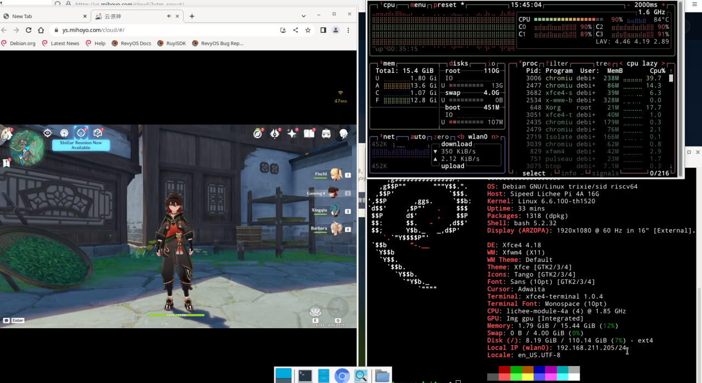

# Genshin-RevyOS-Test

Assess the smoothness of Cloud Genshin Impact running on Chromium bundled with the July 29 RevyOS image, benchmarked on LPI4A hardware.

---

## Test Environment

#### System Information

- System Version: RevyOS 20250729

- Installation Reference: [RevyOS Installation Guide](https://revyos.github.io/docs/)

#### Hardware Information

- Lichee Pi 4A (16GB RAM + 128GB eMMC)

#### Test Information

- Test Date: 2025/08/31

- Test Objective: To test whether Cloud Genshin Impact can run smoothly on Chromium bundled with the July 29 RevyOS image on the LPI4A.

---

## Test Method

Open Cloud Genshin Impact in Chromium directly on the Lichee Pi 4A flashed with RevyOS, playtest it, and evaluate its stability and smoothness.

---

## Test Results

Under a wireless network environment, the network latency displayed by the Cloud Genshin Impact platform is around 40ms. Graphics quality is set to the lowest, with smoothness prioritized. CPU usage peaks at 90%, and the temperature rises to 84°C.

The game visuals are clear and smooth, and the audio is crisp. Audio feedback responds promptly to inputs, but the visual latency is extremely high. With an average delay of around 5 seconds, the game is virtually unplayable.

Cloud Genshin Impact could not be opened in Firefox, so a comparative test could not be performed.
